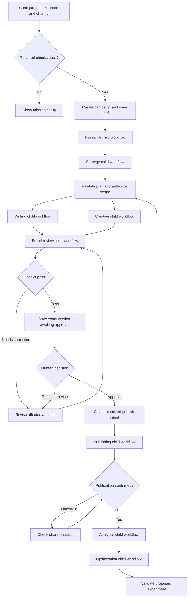

# AI Marketing Manager: workflow and modular implementation blueprint

Prepared: 7 October 2026. Status: design for review; application development has not started.

Confirmed choices: start with a publishing simulator; choose the live channel later. Build and test locally first, then prepare a Render free POC using saved checkpoints and bounded execution.

## 1. Direction and reference project

Gemini is the initial reasoning provider. Every model request passes through a provider gateway. Agent implementations, prompts, model assignments, tool connectors, and workflow definitions have separate versioned configurations.

Reviewed the `Ai deployment Agent` conversation and its existing Python provider and agent registry modules. Carry forward its separation of controller, agents, execution tools, validated contracts, saved checkpoints, configuration testing, and human decisions. Its current local implementation includes simulated deployments; it is a useful reference pattern, not evidence that live marketing integrations already work.

The marketing architecture PDF defines nine specialist roles, a manager, persistent coordination, controlled recovery, and internal campaign records. These remain the target. This blueprint supplies proposed implementation details beyond that brief.

All agents can initially share one Gemini model and one application. Separate roles do not require separate machines. Exact Gemini model identifiers will be selected from the account's available models and stored in configuration rather than scattered through source code.

## 2. Layers and ownership

| Layer | Owns | Replaceable boundary |
|---|---|---|
| React control panel | Setup, campaign creation, previews, decisions, progress | HTTP API contracts |
| FastAPI control service | Authentication, authorization, input validation, campaign commands | Service interfaces |
| Main workflow controller | Task dependencies, checkpoints, deadlines, transitions, recovery | Versioned workflow definition |
| Manager agent | Campaign reasoning, delegation proposals, result interpretation, summaries | Manager input/output contract |
| Child workflow runner | One specialist task, bounded tool/model calls, attempt tracking | Task/result contracts |
| Specialist agents | Role-specific interpretation and proposed outputs | Agent registry |
| Model gateway | Provider routing, capabilities, response normalization, usage | Provider adapter contract |
| Tool execution service | Validated research, media, publishing and analytics operations | Connector contracts |
| Storage | Brand facts, campaign records, artifacts, approvals, audit | Repository and asset-store interfaces |

The manager proposes actions. The controller checks the permitted action, prerequisite evidence, budget and authorization before executing it. External content, comments, research pages, and uploaded documents are inputs, never authority to change permissions.

## 3. Main campaign flow



Audience engagement runs as a separate campaign-linked child workflow when comments or messages arrive. It does not block publication by default. Any approved experiment starts a new recorded cycle; the loop is bounded by campaign dates, spend, iteration count and human decisions. Unresolved external outcomes move to a blocked state rather than looping forever.

### Main workflow steps

1. **Setup gate:** Validate model access, brand facts, required channel permissions and persistent storage. Checks have timestamps and configuration fingerprints. A changed credential or expired check requires revalidation. Draft-only campaigns can proceed without a publishing connector; live publishing cannot.
2. **Create campaign:** Save goal, audience, product, dates, timezone, channel, deliverables, success measures, owner, budget and approval policy. Generate one campaign ID. Distinguish missing information from optional fields.
3. **Freeze inputs:** Snapshot brand facts, policies, workflow version and agent/model configurations. Campaign edits produce new versions.
4. **Research:** Dispatch a task with source requirements and a freshness cutoff. Validate evidence before strategy uses it. User-supplied research can satisfy this step only under explicit policy.
5. **Strategy:** Obtain a structured plan. Validate registered roles, channels, dates, dependency graph, deliverable counts and limits. AI cannot insert arbitrary executable code into the workflow.
6. **Produce:** Dispatch writing and creative tasks when their prerequisites pass. Run independently where possible, with shared concurrency and provider quota limits.
7. **Review:** Validate required fields and channel rules using code; request specialist brand review. The manager inspects findings. Failed claims or missing evidence require revision or owner input.
8. **Approve:** Save a preview and authorization request covering content hash, asset hashes, account, action, schedule window and policy version. Release the runner while waiting. A changed approved artifact invalidates its approval.
9. **Publish:** Recheck current account permissions, approval, content version, campaign status and schedule. Save an operation intent before making the channel request.
10. **Verify:** Record channel receipt, external identifier, actual status and check timestamp. API acceptance means requested or scheduled; only external confirmation establishes publication.
11. **Measure:** Collect a defined metrics window. Missing data is not zero. Code calculates metrics; AI explains results and limitations.
12. **Optimize:** Propose an experiment with evidence, expected cost, affected artifacts and stop conditions. Apply the same validation and authorization gates to changes.
13. **Close or continue:** Close when objectives, deadline or configured cycles finish. Summarize confirmed outcomes, incomplete data and unresolved actions.

Campaign states: `DRAFT`, `NEEDS_SETUP`, `PLANNING`, `PRODUCING`, `REVIEWING`, `AWAITING_APPROVAL`, `SCHEDULED`, `PUBLISHING`, `MONITORING`, `BLOCKED`, `PAUSED`, `COMPLETED`, `CANCELLED`.

Each deliverable has its own state; publishing one of several approved posts does not mark the campaign completed. Manager reviews are saved tasks too, so failures and usage remain visible.

## 4. Shared child workflow

Every specialist uses the same lifecycle:

`QUEUED -> RUNNING -> RESULT_SUBMITTED -> VALIDATING -> ACCEPTED`

Alternative states are `WAITING_INPUT`, `WAITING_APPROVAL`, `RETRY_SCHEDULED`, `NEEDS_REVISION`, `FAILED`, and `CANCELLED`. Submission by an agent is distinct from acceptance by the controller.

1. Claim a task using a lease and concurrency check.
2. Verify input versions, dependencies, deadline and reserved budget.
3. Load only the role's permitted context and tools.
4. Resolve the saved implementation, prompt and provider profile.
5. Perform bounded model/tool steps. Before every tool call, validate tool name, arguments, campaign scope and action authorization.
6. Return a result conforming to the role schema, with evidence and artifact references.
7. Store the submitted result and observed usage. Validate its schema, required evidence and domain rules.
8. Accept it, request a precise revision, schedule a permitted retry, or create an input/approval request.
9. Notify the controller through a saved event. The UI displays the persisted status.

A child cannot independently instruct another child to publish. Follow-up work returns through the controller. Completion of an old attempt cannot overwrite a newer revision; task attempt and input version must match.

## 5. Specialist workflows

| Specialist | Inputs | Internal sequence | Outputs and acceptance checks |
|---|---|---|---|
| Market research | Brief, audience, approved sources, freshness window | Search permitted sources; retain references and dates; compare findings; identify gaps | Research report with source-linked findings, dates and uncertainty. Check source retrieval and relevance; unsupported assertions fail. |
| Campaign strategy | Brief, accepted research, limits | Map goal to audience and channels; propose deliverables, schedule and measures | Campaign plan and dependency graph. Check allowed channels, realistic date ordering, budget and complete success measures. |
| Content writing | Accepted plan, brand snapshot, approved claims, format | Draft copy; attach factual references; perform local self-check | Versioned captions, articles, emails or scripts. Check facts, length, required wording, links and tone through rules plus review. |
| Creative production | Creative brief, licensed/approved assets, formats | Build production instructions; invoke registered media tools; inspect output; save asset | Asset files, previews and provenance. Check dimensions, duration, availability and brand suitability. Media generation uses a separate media adapter when needed. |
| Brand review | Exact copy/assets, brand rules, fact references | Inspect claims, text and creative; list findings and corrections | Findings with severity, artifact location and evidence. Passing requires mandatory rule checks and no unresolved blocking finding. |
| Publishing | Approved artifact version, account, schedule, operation ID | Recheck authority; record intent; request publish; verify channel status | External ID, receipt and observed status. Success requires confirmation of the exact intended content/account. No invented publication results. |
| Performance analytics | Confirmed publication IDs, date range, metric definitions | Fetch data; check completeness; calculate with code; interpret | Metrics snapshot, coverage and calculation version. Check period, timezone, units, denominators and data gaps. |
| Campaign optimization | Accepted metrics, baseline, campaign limits | Compare evidence; identify uncertainty; propose controlled experiment | Proposal with hypothesis, measure, cost, authorization requirements and stop rule. No automatic budget expansion. |
| Audience engagement | Incoming item, publication context, brand facts, escalation rules | Deduplicate; categorize; draft reply; route sensitive items | Classification, draft and evidence. Sending is a separate authorized action; sensitive enquiries await their owner. |

For the first milestone all nine role contracts are defined, while the first complete demonstration focuses on strategy, writing, review and simulated publishing. Research, creative and analytics can use clearly labelled supplied fixtures. No simulated result is displayed as a live integration.

## 6. Communication contracts

Proposed task envelope:

```json
{
  "contract_version": "1",
  "campaign_id": "campaign-id",
  "cycle_id": "cycle-id",
  "task_id": "task-id",
  "role": "content_writing",
  "attempt": 1,
  "input_version": 3,
  "input_refs": ["brief:v3", "brand:v2", "strategy:v1"],
  "output_schema": "content_draft.v1",
  "acceptance_policy": "content_checks.v1",
  "agent_config_ref": "writing-config:v1",
  "allowed_tools": ["read_brand_facts", "read_approved_assets"],
  "deadline_at": "ISO-8601 timestamp",
  "budget_reservation_ref": "reservation-id"
}
```

Proposed result envelope contains task/attempt/input identity, submitted status, schema version, output or artifact references, source evidence, uncertainty, sanitized error category, implementation/provider/model/prompt versions, usage, provider request ID where available, and timestamps.

Small structured outputs can be stored in the database. Large images, videos and reports live in protected asset storage; tasks carry references and hashes. The backend, runner and channel connectors use authenticated requests. The browser never holds provider or channel secrets.

## 7. Swappable model and agent design

Application flow:

`Controller -> Agent registry -> Specialist -> Model gateway -> Configured adapter`

Provider-neutral contracts:

```python
# Design signatures; these are not an implemented application.
class ModelProvider(Protocol):
    async def capabilities(self) -> ProviderCapabilities: ...
    async def generate(self, request: ModelRequest) -> ModelResponse: ...

class SpecialistAgent(Protocol):
    async def run(self, task: AgentTask, services: AgentServices) -> AgentResult: ...
```

`ModelRequest` uses application-owned messages, output schema, tool definitions, generation limits and deadline. `ModelResponse` uses normalized structured output, proposed tool calls, finish reason, request identifier and usage. Provider SDK objects stay inside the adapter. Provider-specific continuation metadata stays in an opaque, versioned session tied to that provider; it is never replayed directly into another provider.

Proposed configuration shape:

```yaml
config_version: 1
profiles:
  primary_reasoning:
    provider: gemini
    model: ${GEMINI_MODEL}
    credential_ref: GEMINI_API_KEY
    timeout_seconds: 60
    max_output_tokens: 4096
agents:
  manager:
    implementation: marketing_manager_v1
    model_profile: primary_reasoning
    prompt_version: manager.v1
    output_schema: manager_decision.v1
  content_writing:
    implementation: content_writer_v1
    model_profile: primary_reasoning
    prompt_version: writing.v1
    output_schema: content_draft.v1
    permitted_tools: [read_brand_facts, read_approved_assets]
limits:
  max_parallel_tasks: 2
  max_model_steps_per_task: 6
  max_tool_calls_per_task: 8
  max_transient_retries: 2
  max_content_revisions: 2
```

These numbers are proposed POC defaults, not Gemini service limits. Configuration loading explicitly expands environment references and validates their presence. Secret values are never written into campaign snapshots.

Replacement rules:

- Change a Gemini model: update the model profile, test access and evaluate its outputs. No workflow change.
- Change to another implemented provider: update provider, model and credential/endpoint references; validate required capabilities and run evaluation.
- Add a completely new provider: implement and register one adapter, then configure it. This requires adapter code, but no rewriting of marketing workflows.
- Replace one specialist: register a new implementation that passes the same input/output contract; change that role's configuration.
- Change prompts, tools or checks: use a new version. Tool permissions are constrained by server policy, not freely editable AI instructions.
- Change providers during a campaign: existing tasks retain their snapshot. A new task/revision can use a recorded configuration migration. Do not silently change an in-flight attempt.

Structured output validity does not establish factual correctness. Unsupported capabilities produce an explicit setup error or a documented application-owned fallback. Do not silently substitute another provider. Image/video capabilities have separate adapter contracts; swapping the reasoning model does not guarantee equivalent media generation.

## 8. Recovery, schedules and authority

| Failure | Controller response |
|---|---|
| Invalid JSON or role output | Store failure; bounded repair request with validation findings |
| Incorrect claim | Supply the conflicting approved fact; revise affected artifact; repeat review |
| Temporary provider/channel error | Bounded retry with backoff; honor provider retry hints and shared quotas |
| Invalid key, revoked access or exhausted daily quota | Stop repeated attempts; request setup or save next eligible retry time |
| Missing input | Save a precise input request; suspend only dependent tasks |
| Publish outcome unknown | Reconcile channel state before any resubmission; block if identity cannot be resolved |
| Worker interruption | Reclaim expired lease; restore checkpoint; reconcile any unfinished external intent |
| Revision limit reached | Block affected work and route evidence to owner |
| Cancellation during publish | Stop new actions; reconcile the already-started action and record any confirmed post |

Every publishing intent has a stable operation ID, account, content hash and schedule window. Use provider idempotency support where available; otherwise combine durable intent records, locks, channel-specific reconciliation and manual resolution. Exactly-once publication cannot be promised for every API.

Failed mandatory checks cannot become successful through AI explanation. Corrections to published content require configured edit/removal authority. New content versions are reviewed again.

Store times in UTC and the campaign's selected timezone. Proposed default display timezone is Asia/Kolkata. Set a late-publication policy: a missed schedule must be surfaced, rescheduled with authority, or skipped; never silently post old campaign content.

## 9. Execution and hosting

The original PDF proposes React, Python/FastAPI, Temporal, PostgreSQL and protected asset storage. Keep this as the full durable execution target.

For Temporal, use the campaign as a parent workflow and specialist tasks as child workflows when independent lifecycle tracking is useful. Model requests, connector calls and storage I/O execute as activities, outside deterministic workflow logic. Human decisions arrive as authenticated workflow signals; timers handle schedules. Temporal service and worker hosting must be provisioned separately. A workflow engine does not make execution continue without available workers.

For the confirmed local-first/free Render POC following the deployment project, use a lighter execution mode: persistent task/checkpoint tables plus bounded Python runner invocations. A local worker executes immediately during local testing. Later, GitHub Actions can run bounded work, using the authenticated API to claim tasks and report results. Approval waits end the current invocation; an approval or wake trigger starts another. This mode is an explicit alternative to Temporal, not a Temporal implementation.

Use durable task intents and an outbox for runner dispatch. If saving a task succeeds but dispatch fails, later reconciliation resends the pending trigger. Use task leases, heartbeats, version checks and unique identities to handle duplicate invocations safely.

Render free web services sleep after idle traffic, may restart, and lose local file changes. Free PostgreSQL expires after 30 days. Therefore persist state/assets outside ephemeral web-service files, and choose a storage lifetime before cloud rollout. Scheduled Actions runs are suitable for a demonstration with timing tolerance; they do not promise exact-time marketing publication. For dependable unattended schedules, use a reliable scheduler/worker or a channel's native scheduling capability, plus reconciliation.

Both modes share domain/agent/provider contracts, but migration to Temporal still requires orchestration implementation and recovery tests. Do not run two independent authoritative controllers for one campaign.

## 10. Data and UI

Core stored records: organizations/users, brand snapshots, briefs/campaigns/cycles, workflow/config snapshots, task attempts, evidence, artifacts and versions, review findings, approvals, publish intents/receipts, metrics snapshots, engagement items, budget reservations, audit events and dispatch outbox.

Audit records include actor, campaign, task, attempt, configuration version, transition, authorization, sanitized tool result, external reference and time. Store evidence and concise decision explanations, not private internal reasoning.

The control panel starts with setup readiness and campaign creation. A campaign screen shows its stage, active specialist, last update, artifact preview, findings and the exact input/decision needed. Status is read from saved state; a closed browser does not erase progress.

Keep detailed agent activity within a campaign view. Settings expose registered providers, model selection, connection tests and limits. Development demo mode is explicit and cannot authorize live external actions. Production mode needs authenticated users, role-based decisions and organization isolation before exposure.

## 11. Proposed code organization

```text
marketing-manager/
  frontend/
  backend/app/
    api/                  # Campaign, settings, approval and status endpoints
    domain/               # Contracts, states, policies and transitions
    agents/               # Manager, specialists and implementation registry
    providers/            # Neutral gateway and Gemini/future adapters
    workflows/            # Campaign/child orchestration interfaces
    runners/              # Local runner; bounded cloud runner; later Temporal
    tools/                # Research, media, publishing, analytics and engagement
    storage/              # Repositories, assets, leases, outbox and audit
    services/             # Approval, context, budgets, validation and recovery
  config/                 # Versioned workflows, agents and profiles
  prompts/                # Versioned role prompts
  tests/                  # Contract, authority, recovery and integration checks
  docs/                   # Setup, workflow reference and developer handover
  deploy.py               # Proposed beginner-friendly local launcher
  .env.example            # Variable names and examples, no credentials
```

Workflow definitions reference registered step types and schemas. Validate dependencies and cycles before activation. Configuration changes cannot load arbitrary remote Python or shell commands.

## 12. Development order and acceptance

1. Build contracts, state transitions, saved tasks, simulator provider and simulator channel. Prove one campaign reaches an approval pause and resumes into verified simulated publication.
2. Add Gemini adapter, model setup tests, quota controls and role prompts. Define all specialist schemas and implement the first campaign's agent roles.
3. Add the campaign UI, exact-version approvals, previews, findings and activity events. Provide a local launcher and developer guide.
4. Integrate the selected live channel and protected asset storage. Validate real account permissions, publish confirmation, uncertain outcomes and actual analytics.
5. Add creative production, full research, optimization and engagement integrations, with separate capability and cost checks.
6. Package the chosen cloud execution mode and verify restart, scheduling and database lifetime. Add Temporal orchestration when its service/worker hosting is agreed.

Required acceptance scenarios:

- Change provider/model assignment without modifying campaign domain logic.
- Replace a specialist while keeping compatible workflow inputs and outputs.
- Reject incompatible model capabilities and invalid schemas clearly.
- Catch an incorrect price, revise and re-review before approval.
- Reject publication of a modified or unapproved version.
- Handle duplicate dispatch, worker crash, stale results and concurrent workers.
- Recover a publish timeout through reconciliation without blind resubmission.
- Pause for missing facts, credentials, quotas and human decisions.
- Keep simulation and live evidence visibly distinct.
- Respect cancellation, task limits, schedule windows and campaign budgets.

No live Gemini or marketing-channel requests have been tested for this project yet. This is an architectural feasibility and implementation specification, not a tested application.

## 13. Decisions still to select

Confirmed: publishing simulator first, live channel later; local first, then Render free POC. Still to select: live publishing channel; POC duration and durable storage; Gemini account/model access and input-data permission; approver identities; first brand and campaign; desired publication timing tolerance. None prevents defining the shared contracts now. Live connectors and final hosting depend on these choices.

## Official references consulted

- [Gemini structured outputs](https://ai.google.dev/gemini-api/docs/structured-output)
- [Gemini function calling](https://ai.google.dev/gemini-api/docs/function-calling)
- [Gemini rate limits](https://ai.google.dev/gemini-api/docs/rate-limits): quotas apply per project; share request limits across agents.
- [Temporal workflow execution](https://docs.temporal.io/workflow-execution)
- [Temporal Python SDK](https://docs.temporal.io/develop/python)
- [Render free service limitations](https://render.com/docs/free)

Service capabilities and account quotas should be checked again when implementation begins.
